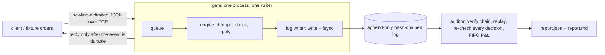

# Trade Seatbelt

Rules before the trade, receipts after. A **Risk Gate** blocks simulated orders that break a trader's own
rules (position size, price band, order rate, loss streak, daily loss, kill switch) and writes every decision to a
tamper-evident, hash-chained log; an **Auditor** replays that log, verifies the chain, computes FIFO P&L with fees,
and reports the first corrupted line.

**Simulated only.** No real orders, no real money, no broker connection. See [docs/LIMITATIONS.md](docs/LIMITATIONS.md)
for what is and is not covered.

## Setup

Needs Python 3.12 (macOS: `brew install python@3.12`) and `make`. Docker is optional (benchmark under limits only).

```
make setup     # creates .venv and installs dependencies
```

## Run

```
make demo      # client -> gate -> log -> auditor -> report, then tamper checks
make demo-recon # reconciliation + counterfactual on generated fixtures, with a 10-line summary
make test      # unit, property-based (Hypothesis), durability and tamper tests
make bench     # benchmark (native); BENCH_N=20000 BENCH_REPS=1 make bench for a quick run
make bench-docker   # same matrix with the gate in a 1 CPU / 512 MB container (needs Docker)
make bench-report FINAL=bench/results/final_<stamp>.json [DOCKER=bench/results/docker_<stamp>.json]
```

`make bench` and `make bench-docker` write raw results to `bench/results/*.json` and a fresh report to
`bench/results/PERFORMANCE_latest.md` (not committed). They never touch the committed `docs/PERFORMANCE.md`, which is
the reported 100k-order run. Only `make bench-report` writes `docs/PERFORMANCE.md`, and only from the result files you name.

`make demo` writes everything under `out/demo/` (`gate.log`, `report.md`, `report.json`).
`make demo-recon` writes `out/recon/` (`report.md/json` with a reconciliation section, `counterfactual.md/json`).

### Reconciliation and counterfactual (your own files)

```
python -m auditor --log gate.log --fills-csv broker.csv [--tolerance-seconds 5] [--lenient] --out report_dir
python -m auditor.counterfactual --csv trades.csv --rules rules.yaml [--lenient] --out report_dir
```

Both read a broker-style CSV: `ts,client_order_id,symbol,side,qty,price,fee` (`client_order_id` and `fee` optional, money in
integer minor units, `ts` ISO-8601 with an offset or epoch nanoseconds). A float price, a bad side or a malformed row fails the
whole file and names the row (row 1 is the header); `--lenient` collects all bad rows instead.

- **Reconciliation** compares the log's ACCEPTED fills with the CSV and files every item as `MATCHED`, `MISSING_IN_BROKER`,
  `MISSING_IN_LOG`, `QTY_MISMATCH`, `PRICE_MISMATCH` or `AMBIGUOUS`, each citing the log seq and the CSV row. Anything with more
  than one candidate and no id is `AMBIGUOUS` and is never guessed. Policy and tolerance: top of `auditor/recon.py`.
- **Counterfactual** runs the trades in time order through the gate's own `check()` and `Book` and reports what would have been
  blocked (CSV row, rule, limit, value) and the P&L impact. It is a sequential replay, not a subtraction, and assumes every accepted
  order fills fully at its price. Method and assumptions: top of `auditor/counterfactual.py`.


## Architecture



- `core/` shared by gate and auditor: event schema, canonical JSON + hash chain, pure `check()`, FIFO ledger, log reader/writer.
- `gate/` asyncio TCP server; one task owns the state and the log (single writer). Replies are sent only after the fsync that covers their event.
- `auditor/` separate process; deterministic; needs the same `rules.yaml` as the gate. Also: `fills_csv.py` (strict broker-CSV reader), `recon.py` (log vs broker), `counterfactual.py` (past trades vs the rules).
- `client/` sends orders from a fixture file. `fixtures/` generates them with a fixed seed and hand-computed expected totals.
- `bench/` workload, load generator, harness and report generator. `tests/`. `docs/`.

Not built yet: `api/`, `web/`, and the optional Gemini / ElevenLabs / Tiger Data integrations.

## Results and docs

- Performance (native and Docker, measured; the committed 100k-order run): [docs/PERFORMANCE.md](docs/PERFORMANCE.md); raw data in `bench/results/*.json`; your own run: `bench/results/PERFORMANCE_latest.md`.
- Invariants and the tests that try to break them: [docs/INVARIANTS.md](docs/INVARIANTS.md)
- Limitations and the next bottleneck: [docs/LIMITATIONS.md](docs/LIMITATIONS.md)
- What we built vs. what we used: [docs/DISCLOSURE.md](docs/DISCLOSURE.md)

## License

MIT, Copyright (c) 2026 aarnav.dev. See [LICENSE](LICENSE). Third-party packages and their licenses are listed in [docs/DISCLOSURE.md](docs/DISCLOSURE.md).
