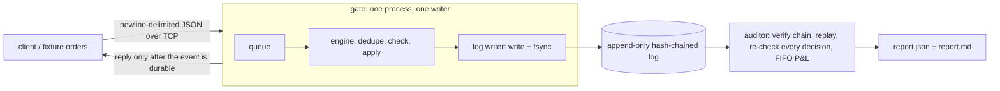

# Trade Seatbelt

Rules before the trade, receipts after. A **Risk Gate** blocks simulated orders that break a trader's own
rules (position size, price band, order rate, loss streak, daily loss, kill switch) and writes every decision to a
tamper-evident, hash-chained log; an **Auditor** replays that log, verifies the chain, computes FIFO P&L with fees,
and reports the first corrupted line.

**Simulated only.** No real orders, no real money, no broker connection. See [docs/LIMITATIONS.md](docs/LIMITATIONS.md)
for what is and is not covered.

## Setup

Needs Python 3.12 (macOS: `brew install python@3.12`) and `make`. Docker is optional (benchmark under limits only).

```
make setup     # creates .venv and installs dependencies
```

## Run

```
make demo      # client -> gate -> log -> auditor -> report, then tamper checks
make test      # unit, property-based (Hypothesis), durability and tamper tests
make bench     # benchmark (native); BENCH_N=20000 BENCH_REPS=1 make bench for a quick run
make bench-docker   # same matrix with the gate in a 1 CPU / 512 MB container (needs Docker)
```

`make demo` writes everything under `out/demo/` (`gate.log`, `report.md`, `report.json`).

## Architecture



- `core/` shared by gate and auditor: event schema, canonical JSON + hash chain, pure `check()`, FIFO ledger, log reader/writer.
- `gate/` asyncio TCP server; one task owns the state and the log (single writer). Replies are sent only after the fsync that covers their event.
- `auditor/` separate process; deterministic; needs the same `rules.yaml` as the gate.
- `client/` sends orders from a fixture file. `fixtures/` generates them with a fixed seed and hand-computed expected totals.
- `bench/` workload, load generator, harness and report generator. `tests/`. `docs/`.

Not built yet: the broker-CSV reconciliation, `api/`, `web/`, and the optional Gemini / ElevenLabs / Tiger Data integrations.

## Results and docs

- Performance (native and Docker, measured): [docs/PERFORMANCE.md](docs/PERFORMANCE.md); raw data in `bench/results/*.json`.
- Invariants and the tests that try to break them: [docs/INVARIANTS.md](docs/INVARIANTS.md)
- Limitations and the next bottleneck: [docs/LIMITATIONS.md](docs/LIMITATIONS.md)
- What we built vs. what we used: [docs/DISCLOSURE.md](docs/DISCLOSURE.md)
