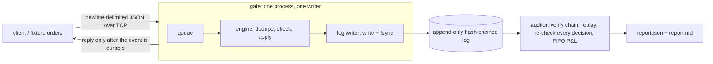

# Trade Seatbelt

Rules before the trade, receipts after. A **Risk Gate** blocks simulated orders that break a trader's own
rules (position size, price band, order rate, loss streak, daily loss, kill switch) and writes every decision to a
tamper-evident, hash-chained log; an **Auditor** replays that log, verifies the chain, computes FIFO P&L with fees,
and reports the first corrupted line.

**Simulated only.** No real orders, no real money, no broker connection. See [docs/LIMITATIONS.md](docs/LIMITATIONS.md)
for what is and is not covered.

## Setup

Needs Python 3.12 (macOS: `brew install python@3.12`) and `make`. Docker is optional (benchmark under limits only).

```
make setup     # creates .venv and installs dependencies
```

## Run

```
make demo      # client -> gate -> log -> auditor -> report, then tamper checks
make follow    # one paper follower over a leader's feed: pre-filters, gate, copier ledger, plain-English explanations (real replay data if fetchable, else the labelled SYNTHETIC FIXTURE)
make follow-chain # same, with the leader's signals read from Solana devnet (falls back to cache, then local feed, and says so)
make devnet-check # publish 10 seeded signals to devnet, read them back, compare with feed.jsonl (funded key from make leaders-setup)
make api && make web  # then open http://127.0.0.1:5173 and follow the five pages in order (see "The site" below; paper only)
make demo-recon # reconciliation + counterfactual on generated fixtures, with a 10-line summary
make api       # read-only API for the dashboard on 127.0.0.1:8000 (never on the order path)
make web       # dashboard dev server on http://127.0.0.1:5173 (run `make api` in another terminal; needs Node 20+)
make web-test  # front-end unit tests (browser-side hash recomputation, money formatting)
make test      # unit, property-based (Hypothesis), durability and tamper tests
make bench     # benchmark (native); BENCH_N=20000 BENCH_REPS=1 make bench for a quick run
make bench-docker   # same matrix with the gate in a 1 CPU / 512 MB container (needs Docker)
make bench-report FINAL=bench/results/final_<stamp>.json [DOCKER=bench/results/docker_<stamp>.json]
```

`make bench` and `make bench-docker` write raw results to `bench/results/*.json` and a fresh report to
`bench/results/PERFORMANCE_latest.md` (not committed). They never touch the committed `docs/PERFORMANCE.md`, which is
the reported 100k-order run. Only `make bench-report` writes `docs/PERFORMANCE.md`, and only from the result files you name.

`make demo` writes everything under `out/demo/` (`gate.log`, `report.md`, `report.json`).
`make demo-recon` writes `out/recon/` (`report.md/json` with a reconciliation section, `counterfactual.md/json`).

### Reconciliation and counterfactual (your own files)

```
python -m auditor --log gate.log --fills-csv broker.csv [--tolerance-seconds 5] [--lenient] --out report_dir
python -m auditor.counterfactual --csv trades.csv --rules rules.yaml [--lenient] --out report_dir
```

Both read a broker-style CSV: `ts,client_order_id,symbol,side,qty,price,fee` (`client_order_id` and `fee` optional, money in
integer minor units, `ts` ISO-8601 with an offset or epoch nanoseconds). A float price, a bad side or a malformed row fails the
whole file and names the row (row 1 is the header); `--lenient` collects all bad rows instead.

- **Reconciliation** compares the log's ACCEPTED fills with the CSV and files every item as `MATCHED`, `MISSING_IN_BROKER`,
  `MISSING_IN_LOG`, `QTY_MISMATCH`, `PRICE_MISMATCH` or `AMBIGUOUS`, each citing the log seq and the CSV row. Anything with more
  than one candidate and no id is `AMBIGUOUS` and is never guessed. Policy and tolerance: top of `auditor/recon.py`.
- **Counterfactual** runs the trades in time order through the gate's own `check()` and `Book` and reports what would have been
  blocked (CSV row, rule, limit, value) and the P&L impact. It is a sequential replay, not a subtraction, and assumes every accepted
  order fills fully at its price. Method and assumptions: top of `auditor/counterfactual.py`.


## Architecture



- `core/` shared by gate and auditor: event schema, canonical JSON + hash chain, pure `check()`, FIFO ledger, log reader/writer.
- `gate/` asyncio TCP server; one task owns the state and the log (single writer). Replies are sent only after the fsync that covers their event.
- `auditor/` separate process; deterministic; needs the same `rules.yaml` as the gate, and since log v2 it can tell: the gate records the hash of the rules it started with inside the chain (`type: RULES`, one per start whose rules changed), and the report says `Rules: MATCH`, `MISMATCH` (also a `RULES_MISMATCH` finding), `PARTIAL` or `NOT_RECORDED` (an older v1 log) before any P&L. Also: `fills_csv.py` (strict broker-CSV reader), `recon.py` (log vs broker), `counterfactual.py` (past trades vs the rules).
- `client/` sends orders from a fixture file. `fixtures/` generates them with a fixed seed and hand-computed expected totals.
- `bench/` workload, load generator, harness and report generator. `tests/`. `docs/`.

- `api/` thin FastAPI for the dashboard, bound to 127.0.0.1 only: `GET /report`, `GET /events/stream` (SSE tail of the log), `POST /demo/run` (the demo flow with its own gate process in a temp dir), `POST /tamper` (edits a *copy* of the log, verifies the copy, returns the first bad seq; the real log is only read and no path is taken from the client), `GET|POST /recon` and `GET|POST /counterfactual` (bundled fixtures, or your CSV as the raw request body, 1 MB cap, errors name the row), `GET /bench` (stored numbers from `bench/results/*.json`, nothing computed), `GET /invariants` (the list from `docs/INVARIANTS.md`; test status only from the JUnit file `make test` writes to `out/pytest-junit.xml`, otherwise "unknown").

- `web/` Vite + React + TypeScript site: `/` landing, `/rules`, `/follow`, `/dashboard`, `/audit` (details below).

Not built yet: the optional Gemini / ElevenLabs / Tiger Data integrations.

## The site (`web/`)

```
make api     # terminal 1: 127.0.0.1:8000, never on the order path
make web     # terminal 2: http://127.0.0.1:5173 (Vite proxies /api to the API; needs Node 20+)
```

Five pages, dark theme with a 3D chain (a 2D version on phones, with reduced motion, or without WebGL), no login. Demo steps, in order:

1. **`/` Landing.** A slow 3D version of the five steps (sample signals, labelled as an illustration), what the product does, how Solana devnet is used (and what it does not do), and an example rejection.
2. **`/rules`** Pick Cautious, Balanced or Active, or edit the four limits, then **Save**. The API validates them against the
   `rules.yaml` schema and stores them in `profile/rules.json` (gitignored); the repo's `rules.yaml` is never changed. A follow run is
   refused (409) until rules are saved.
3. **`/follow`** Choose a leader, a source (Auto, Chain (devnet) or Local feed), how much to copy, optional session limits and a pace,
   then **Start**. A **Signal source** panel then says which leader and strategy, where the signals actually came from (live Solana devnet, a saved copy, or a local feed that is **not** from Solana, including any fallback and why), the publisher key and the first transaction with an Explorer link; every row carries the same provenance, and the counts are split into "skipped before the gate" (the copier never sent it) and "blocked by your rules" (the gate refused it). Rows appear as signals are processed with a strip of blocks above them (hover a block to highlight its row, click for the drawer); click a row for the plain-English why. The badge text is read from the run's manifest.
4. **`/dashboard`** and 5. **`/audit`** are **still placeholders**. `/dashboard` shows only a mini chain of the latest demo log; `/audit` has the medium chain with Run demo, Verify and a tamper demo on a copy. Their full versions (P&L, positions, rejects by rule, log table, report / recon / counterfactual views, export) are planned and not built. The old `/app` routes redirect to the new pages.

`make follow` and `make follow-chain` do the same from the terminal. `node web/e2e/shots.mjs` (both servers running, `npx playwright install chromium`
once) saves one screenshot per page and checks the rules-to-follow flow, overflow and text contrast.

## Results and docs

- Performance (native and Docker, measured; the committed 100k-order run): [docs/PERFORMANCE.md](docs/PERFORMANCE.md); raw data in `bench/results/*.json`; your own run: `bench/results/PERFORMANCE_latest.md`.
- Invariants and the tests that try to break them: [docs/INVARIANTS.md](docs/INVARIANTS.md)
- Limitations and the next bottleneck: [docs/LIMITATIONS.md](docs/LIMITATIONS.md)
- What we built vs. what we used: [docs/DISCLOSURE.md](docs/DISCLOSURE.md)

## License

MIT, Copyright (c) 2026 aarnav.dev. See [LICENSE](LICENSE). Third-party packages and their licenses are listed in [docs/DISCLOSURE.md](docs/DISCLOSURE.md).
